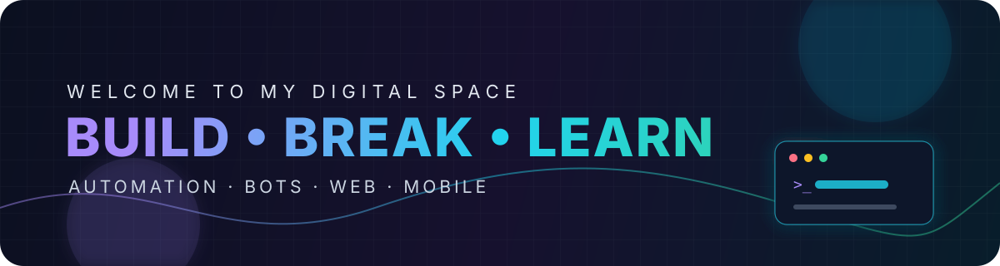
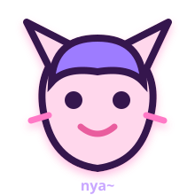

 

 

  

## ✦ About this space

A little corner for experiments, useful tools, automation, bots, web ideas, and mobile builds.

I like turning chaotic ideas into working systems — preferably with good vibes, cute visuals, and too much coffee.

### `code` ♡ `create` ♡ `iterate` ♡ `repeat`

## ☆ Current arc

- Building practical tools and integrations
- Exploring bots, backend systems, and automation
- Learning by shipping, breaking, fixing, and trying again

✧ welcome to the side quest ✧

